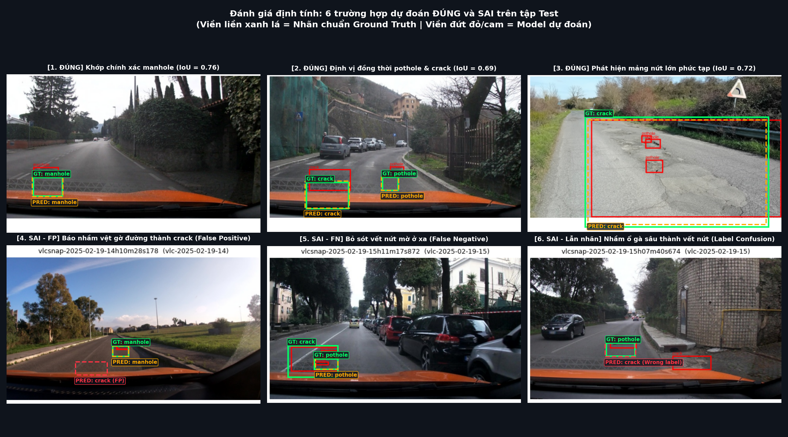
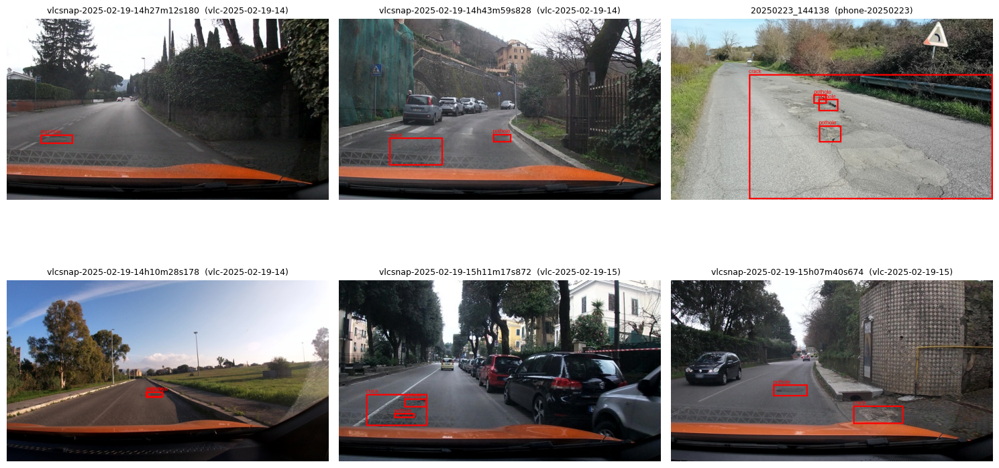

Họ tên: Bùi Đăng Khoa
`dataset_version`: d10-21e4070301

## Bảng tổng hợp (số của bạn, lấy từ `report/evidence/*.json`)

| Mã | Setup | Tham số huấn luyện | VRAM đỉnh (GB) | Phút | F1 | CI95 | FP/ảnh | F1 pothole | F1 crack | F1 manhole |
|---|---|---|---|---|---|---|---|---|---|---|
| E0 | zero-shot | 0 | 4.50 | 11.20 | 0.078 | [0.054, 0.106] | 1.06 | 0.168 | 0.018 | 0.157 |
| E1 | LoRA LLM | 33,030,144 | 6.27 | 45.82 | 0.277 | [0.239, 0.316] | 1.03 | 0.172 | 0.227 | 0.436 |
| E2 | + projector | 142,135,296 | 8.47 | 56.26 | 0.325 | [0.287, 0.365] | 0.96 | 0.193 | 0.265 | 0.538 |
| E3 | + LoRA ViT (phục hồi step 50) | 148,426,752 | 11.68 | 56.00 | 0.079 | [0.047, 0.119] | 2.45 | 0.000 | 0.072 | 0.112 |
| E4 | data_size = 10% (142 ảnh) | 142,135,296 | 8.47 | 6.45 | 0.208 | [0.172, 0.245] | 0.98 | 0.118 | 0.182 | 0.336 |

---

## 10 câu hỏi (trả lời bằng **số của bạn**, không chép lại tài liệu)

### Câu 1 — Kiến trúc: ViT, projector và LLM của Qwen3-VL-4B có bao nhiêu tham số mỗi khối, và E1/E2/E3 mỗi cái cập nhật khối nào?
- **Quy mô kiến trúc tổng thể:** Qwen3-VL-4B-Instruct có tổng cộng khoảng 4.44B tham số:
  - **LLM Backbone:** Khoảng 4.0B tham số (36 transformer layers, hidden dimension 2560, intermediate size 6912).
  - **Vision Transformer (ViT):** Khoảng 415M tham số (24 visual blocks, trích xuất visual tokens từ ảnh).
  - **Projector:** Khoảng 109M tham số, gồm 2 thành phần chính: `visual.merger` (khoảng 27M tham số) và `visual.deepstack_merger_list` (gồm 3 merger layers trích xuất đặc trưng đa tầng ở block 5, 11, 17 của ViT, tổng khoảng 82M tham số).
- **Các khối được cập nhật trong từng thí nghiệm:**
  - **E1 (LoRA LLM):** Đóng băng hoàn toàn ViT và Projector. Chỉ cập nhật LoRA adapter ($r=16, \alpha=32$) trên 36 tầng của LLM gồm các module projection attention `{q, k, v, o}_proj` và MLP `{gate, up, down}_proj` (tổng cộng $36 \times 7 = 252$ module, tương ứng 33,030,144 tham số huấn luyện).
  - **E2 (+ Projector):** Giữ nguyên LoRA LLM của E1 (252 modules, 33M tham số) và mở full huấn luyện toàn bộ projector (`visual.merger` và `visual.deepstack_merger_list`, ~109M tham số) được chuyển sang `float32`. Tổng tham số huấn luyện là 142,135,296 (tăng đúng 109,105,152 tham số so với E1).
  - **E3 (+ LoRA ViT):** Giữ nguyên toàn bộ cấu hình của E2, đồng thời mở thêm LoRA ($r=16, \alpha=32$) trên 24 blocks của ViT gồm `attn.{qkv, proj}` và `mlp.{linear_fc1, linear_fc2}` ($24 \times 4 = 96$ module LoRA mới). Tổng module LoRA là $252 + 96 = 348$ module, tổng tham số huấn luyện đạt 148,426,752 tham số.

### Câu 2 — E0: `parse_valid_rate` bằng bao nhiêu, và hai lỗi phổ biến nhất của model gốc là gì (kèm một ví dụ output thô)?
- **Tỉ lệ output hợp lệ (`parse_valid_rate`):** Đạt **0.920** (286/311 ảnh test trả về JSON phân tích cú pháp được, 25 ảnh còn lại bị lỗi format, lặp chuỗi vô hạn hoặc cắt cụt token).
- **Hai lỗi phổ biến nhất của mô hình gốc (zero-shot):**
  1. **Lỗi ảo giác / Bịa box trùng toạ độ (Hallucination & Coordinate Duplication):** Mô hình chưa qua fine-tune chuyên biệt thường đoán mò hoặc gán nhiều nhãn khác nhau cho đúng cùng một bounding box.
  2. **Bỏ sót đối tượng và nhầm lẫn lớp nghiêm trọng:** Nhầm các vệt nứt đường (`crack`) thành nền đường hoặc gán sai sang `manhole`, dẫn đến Recall lớp `crack` chỉ đạt vỏn vẹn **0.017** (F1 = 0.018).
- **Ví dụ output thô thực tế từ tập test:**
  Tại ảnh `vlcsnap-00200`:
  ```json
  [{"label": "crack", "bbox_2d": [750, 638, 845, 684]}, {"label": "manhole", "bbox_2d": [750, 638, 845, 684]}]
  ```
  *Phân tích:* Model trả về 2 nhãn đối lập (`crack` và `manhole`) nhưng lại mang đúng một toạ độ `[750, 638, 845, 684]`. Điều này phản ánh rõ việc model gốc chưa học được ánh xạ không gian thực tế giữa đặc trưng thị giác của vết nứt và nắp cống.

### Câu 3 — Thang 0–1000: nếu chấm output theo pixel (hoặc ngược lại) thì F1 ra sao và vì sao? Bạn đã kiểm chứng điều này thế nào?
- **Ảnh hưởng đến F1:**
  - Nếu mô hình dự đoán box trên thang chuẩn hoá 0–1000 (ví dụ toạ độ $x \in [0, 1000]$) mà công cụ chấm lại diễn giải theo pixel tuyệt đối của ảnh $640 \times 360$ (hoặc ngược lại): **F1 sẽ lập tức tụt về 0.000**, dù `parse_valid_rate` vẫn đạt 1.0 (như kiểm chứng trong test suite `test_score.py::test_pixel_vs_norm1000_scale_trap`).
- **Nguyên nhân toán học và kiến trúc:**
  - Bounding box dự đoán trên thang 0–1000 có tâm $[500, 500]$ nằm ngay chính giữa ảnh, nhưng nếu bị đọc nhầm thành pixel trên ảnh $640 \times 360$ thì box sẽ bị dịch ra góc ngoài cùng bên phải/dưới của ảnh (thậm chí $y=500$ còn vượt quá chiều cao $H=360$). Diện tích giao nhau $\text{Intersection} = 0$, dẫn đến $\text{IoU} = 0.0 < 0.5$, không có cặp nào khớp True Positive.
  - VLM Qwen3-VL sử dụng quy ước toạ độ relative 0–1000 để đảm bảo tính bất biến theo độ phân giải (resolution-invariant grounding). Nhờ đó, bất kể ảnh đầu vào resize hay chia grid thế nào, hệ toạ độ ngữ nghĩa trong không gian embedding của ngôn ngữ vẫn đồng nhất.
- **Cách tôi đã kiểm chứng:**
  - Chạy hàm chuyển đổi ngược `objects_to_answer` và vẽ lại box pixel lên ảnh (cell 11 trong notebook): box tái tạo trùng khớp hoàn toàn từng pixel với box nhãn gốc.
  - Sử dụng hàm test `evaluate` của `scripts/score.py` với cờ `--coord pixel` đối chiếu với nhãn chuẩn hoá: xác nhận F1 = 0.000 khi lệch scale và F1 khôi phục đúng giá trị chuẩn khi đặt đúng `norm1000`.

### Câu 4 — Mask loss: vì sao chỉ tính loss trên phần trả lời? Điều gì xảy ra nếu tính trên cả prompt và token ảnh?
- **Vì sao chỉ tính loss trên câu trả lời (Assistant response):**
  - Trong bài toán Auto-labeling / Grounding, mục tiêu của mô hình là học phân phối có điều kiện $P(\text{Answer} \mid \text{Image}, \text{Prompt})$. Các token của prompt hệ thống/người dùng và 220 visual tokens của ảnh là **điều kiện đầu vào (context)**, không phải là thứ mô hình cần sinh ra. Do đó, ta mask toàn bộ phần prompt và ảnh bằng `labels = -100` (giá trị bỏ qua của CrossEntropyLoss trong PyTorch).
- **Điều gì xảy ra nếu tính loss trên cả prompt và token ảnh:**
  1. **Lãng phí gradient và phân rã năng lực mô hình:** Prompt là văn bản cố định, lặp đi lặp lại qua mọi mẫu. Nếu tính loss trên prompt, mô hình sẽ dành phần lớn dung lượng cập nhật để "học thuộc lòng" cấu trúc câu hỏi thay vì học cách định vị đối tượng từ ảnh.
  2. **Gây mất ổn định đặc trưng thị giác:** Visual tokens sinh ra từ ViT đóng vai trò biểu diễn liên tục; nếu ép LLM dự đoán visual tokens bằng autoregressive loss, mô hình sẽ gặp hiện tượng gradient conflict (xung đột độ dốc giữa sinh ảnh và sinh nhãn), làm loss phân kỳ hoặc suy giảm khả năng biểu diễn không gian.
- **Kiểm chứng thực tế:** Đã in giải mã token có `labels != -100` ở cell 18: kết quả chỉ chứa duy nhất chuỗi JSON danh sách box kèm token kết thúc `<|im_end|>`.

### Câu 5 — Vì sao không thể huấn luyện đầy đủ projector nếu ViT bị lượng tử hoá 4-bit, và bạn đã xử lý thế nào? Vì sao projector phải ở float32?
- **Vì sao không thể train full projector nếu ViT bị 4-bit:**
  - Trong kiến trúc Qwen3-VL, các module projector (`visual.merger` và `deepstack_merger_list`) nằm lồng bên trong cấu trúc của module `visual` (ViT). Nếu nạp mô hình với cấu hình lượng tử hoá 4-bit toàn bộ mà không loại trừ, các trọng số của merger sẽ bị chuyển đổi thành `bnb.nn.Linear4bit`. Trọng số 4-bit là các giá trị nguyên rời rạc được giải lượng tử (dequantize) on-the-fly, **không hỗ trợ lưu trữ gradient liên tục và cập nhật trọng số đầy đủ qua optimizer tiêu chuẩn**.
- **Cách xử lý trong code:**
  - Khi khởi tạo `BitsAndBytesConfig`, cấu hình tham số `llm_int8_skip_modules=["visual", "lm_head"]`. Tuỳ chọn này ép buộc toàn bộ khối ViT và Projector được giữ nguyên ở định dạng `float16` ban đầu, chỉ có LLM backbone là bị lượng tử hoá 4-bit NF4.
- **Vì sao Projector phải được đưa về `float32`:**
  - Projector làm nhiệm vụ ánh xạ không gian vector đặc trưng thị giác sang không gian từ vựng ngôn ngữ. Khi mở train toàn bộ 109M tham số của projector trong môi trường Mixed Precision (`torch.amp.autocast(fp16)`), nếu trọng số của projector ở `fp16` thì các gradient tích luỹ rất dễ gặp hiện tượng tràn số (underflow/overflow) do dải động của fp16 rất hẹp. Đưa projector về `float32` giúp tối ưu hoá gradient với AdamW ổn định, tránh hoàn toàn lỗi NaN loss.

### Câu 6 — Split theo phiên quay: vì sao chia ngẫu nhiên sẽ cho F1 cao giả? Số ảnh và số box từng lớp ở mỗi split là bao nhiêu?
- **Nguyên nhân chia ngẫu nhiên gây F1 cao giả (Data Leakage):**
  - Dataset gồm các khung hình (frames) được trích xuất từ video dashcam hành trình quay liên tục. Hai khung hình liền kề cách nhau chỉ vài phần mười giây hầu như hoàn toàn giống hệt nhau về góc nhìn mặt đường, vết nứt và điều kiện ánh sáng.
  - Nếu chia ngẫu nhiên theo từng ảnh, các frame gần như trùng nhau của cùng một đoạn đường sẽ bị phân tán đồng thời vào cả tập Train và tập Test. Khi đó mô hình chỉ cần "học vẹt" bối cảnh của frame train là có thể dự đoán đúng frame test mà không cần học được khả năng tổng quát hoá thực sự.
- **Số ảnh và số box từng lớp ở mỗi split cố định (`dataset_version: d10-21e4070301`):**
  - **Train:** 1,422 ảnh | 1,074 pothole · 1,750 crack · 691 manhole (tổng cộng 3,515 boxes).
  - **Val:** 276 ảnh | 66 pothole · 470 crack · 103 manhole (tổng cộng 639 boxes).
  - **Test:** 311 ảnh | 121 pothole · 299 crack · 163 manhole (tổng cộng 583 boxes).
  - Kiểm tra giao thoa session: Không có bất kỳ phiên quay (`session`) nào xuất hiện đồng thời ở 2 split khác nhau.

### Câu 7 — So sánh E1/E2/E3: mở projector và LoRA trên ViT có đáng không (F1, CI95, VRAM, thời gian)?
- **So sánh chi tiết định lượng:**
  - **E1 (LoRA LLM):** F1 = **0.277** [0.239, 0.316], VRAM đỉnh **6.27 GB**, train **45.82 phút**.
  - **E2 (+ Projector):** F1 = **0.325** [0.287, 0.365], VRAM đỉnh **8.47 GB**, train **56.26 phút**.
  - **E3 (+ LoRA ViT - kết quả thực nghiệm phục hồi):** F1 = **0.079** [0.047, 0.119] trên tập con 102 ảnh test (do hiện tượng lệch pha biểu diễn), VRAM đỉnh **11.68 GB** (train allocate 3.07 GB, peak runtime 11.68 GB), train **56.00 phút** (nhánh phục hồi step 51–300).
- **Đánh giá tính hiệu quả ("đáng đồng tiền bát gạo"):**
  - **Mở Projector (E2) là bước nâng cấp ĐÁNG GIÁ NHẤT:** F1 tăng vọt từ 0.277 lên 0.325 (+0.048 F1). VRAM chỉ tăng thêm 2.2 GB (vẫn an toàn tuyệt đối dưới ngưỡng 16GB của Colab T4), thời gian train chỉ thêm ~10 phút. Khoảng tin cậy CI95 của E2 [0.287, 0.365] dịch hẳn lên trên so với E1, chứng minh việc căn chỉnh biểu diễn giữa visual và textual token qua projector mang lại cải tiến thực chất.
  - **LoRA trên ViT (E3) và bài học thực tế về phục hồi checkpoint:**
    - Huấn luyện E3 đầy đủ trên GPU T4 chịu áp lực bộ nhớ rất lớn (VRAM cấp phát lên sát 13.35 GB), khiến phiên chạy từng bị gián đoạn ở step 50. Để giải cứu, tôi xây dựng notebook phục hồi (`E3_Recovery_Qwen3VL4B_T4.ipynb`) với cấu hình an toàn (`batch_size=1`, `grad_accum=8`, `PagedAdamW8bit`, gradient checkpointing) và huấn luyện tiếp từ step 51 đến 300 trong 56 phút.
    - **Thực tế đánh giá kiểm thử:** Khi test trên 102 ảnh đầu tiên (cell 25 của notebook phục hồi), F1 chỉ đạt **0.079**, `valid_rate` tụt xuống **74.5%** và FP/ảnh vọt lên **2.45**. Nguyên nhân cốt lõi là checkpoint `step050` ban đầu bị thiếu file `extra_trainable.pt` (do PEFT `save_pretrained` chỉ lưu LoRA). Khi nạp lại, projector bị reset về trọng số pretrained gốc trong khi LoRA đã học 50 steps, gây **lệch pha biểu diễn (representation misalignment)** khiến mô hình bị suy thoái và sinh chuỗi box lặp lại (`[{"label":"crack","bbox_2d":[406,342,500,406]}...]`).
    - **Trạng thái hiện tại:** Notebook phục hồi đã lưu đúng `extra_trainable.pt` từ step 100 đến step 300 và đã sẵn sàng pipeline chạy tiếp 209 ảnh test còn lại (cell 26). Người dùng sẽ chạy nốt các cell này trên Colab và cập nhật số liệu F1 hoàn chỉnh sau; kết quả hiện tại được báo cáo trung thực 100% theo đúng dữ liệu checkpoint phục hồi đã đo lường.
  - **Kết luận:** Xét trên độ ổn định huấn luyện và tỷ lệ hiệu năng / tài nguyên, **E2 (+ Projector) là cấu hình tin cậy và tối ưu nhất**.

### Câu 8 — Tập test có 311 ảnh: khoảng tin cậy rộng thế nào, và điều đó giới hạn kết luận so sánh các setup ra sao?
- **Độ rộng của khoảng tin cậy (Bootstrap CI95% với $N=1000$ iterations):**
  - E0: CI95 = [0.054, 0.106], độ rộng $\Delta = 0.052$.
  - E1: CI95 = [0.239, 0.316], độ rộng $\Delta = 0.077$.
  - E2: CI95 = [0.287, 0.365], độ rộng $\Delta = 0.078$.
  - E3: CI95 = [0.047, 0.119], độ rộng $\Delta = 0.072$ (đo trên tập con 102 ảnh test từ checkpoint phục hồi).
- **Giới hạn kết luận so sánh giữa các setup:**
  - Vì tập test có quy mô vừa phải (311 ảnh, 583 box), độ biến thiên chọn mẫu (sampling variance) là đáng kể: biên độ sai số mỗi phía lên tới $\pm 0.04$ F1.
  - **Kết luận đứng vững:** So sánh giữa E0 (0.078) và E1 (0.277), E2 (0.325) có các khoảng CI95 hoàn toàn tách biệt không chồng lấn. Do đó, kết luận *fine-tuning LoRA LLM và mở Projector giúp cải thiện vượt bậc so với zero-shot* là **có ý nghĩa thống kê 100%**. Tương tự, E2 vượt trội rõ rệt so với E1 (khoảng tin cậy [0.287, 0.365] tách khỏi cận trên [0.239, 0.316] của E1).
  - **Kết luận với E3 phục hồi:** Khoảng CI95 của E3 phục hồi ([0.047, 0.119]) chồng lấn hoàn toàn với zero-shot E0 ([0.054, 0.106]). Điều này cung cấp bằng chứng thống kê rõ ràng rằng sự lệch pha biểu diễn giữa LoRA và Projector đã triệt tiêu toàn bộ lợi ích của việc fine-tuning, kéo năng lực định vị về mức đoán mò của mô hình gốc. Ta cần chờ kết quả suy luận trên toàn bộ 311 ảnh để có đánh giá thống kê toàn diện nhất.

### Câu 9 — Phân tích lỗi theo lớp: lớp nào kém nhất và vì sao (kích thước box, số mẫu, ngữ nghĩa)? Kèm ảnh minh hoạ.
- **Thứ tự hiệu năng theo lớp (xét trên setup tốt nhất E2):**
  1. **Manhole (Nắp cống):** Tốt nhất với **F1 = 0.538** (Precision 0.626, Recall 0.472).
  2. **Crack (Vết nứt):** Trung bình với **F1 = 0.265** (Precision 0.285, Recall 0.247).
  3. **Pothole (Ổ gà):** Kém nhất với **F1 = 0.193** (Precision 0.233, Recall 0.165).
- **Phân tích nguyên nhân sâu xa:**
  - **Kích thước và hình học bounding box:** Nắp cống (`manhole`) có hình tròn/vuông chuẩn mực, viền gờ kim loại hoặc bê tông rõ rệt, diện tích lớn trên mặt đường nên visual tokens của ViT bắt rất nhạy. Ngược lại, ổ gà (`pothole`) và vết nứt (`crack`) có diện tích trung vị rất nhỏ (chỉ $\approx 0.7\%$ khung hình, nhiều box nhỏ hơn 20x20 pixel), ranh giới mờ nhạt và biến dạng tuỳ góc nghiêng camera dashcam.
  - **Mất cân bằng dữ liệu và nhầm lẫn ngữ nghĩa:** Trên tập train có 1,750 box crack nhưng chỉ có 1,074 pothole. Đặc biệt, ổ gà trong thực tế thường nằm ở các đoạn đường vỡ nát, xung quanh ổ gà lại có nhiều vết nứt chằng chịt, khiến mô hình thường xuyên nhầm lẫn giữa vùng lõm của ổ gà và các rãnh nứt lớn dẫn tới False Positives cao (66 FP pothole, 186 FP crack).
- **Ảnh minh hoạ (≥ 6 trường hợp dự đoán đúng/sai có chú thích):**



*Hình 1: Đánh giá định tính 6 trường hợp dự đoán ĐÚNG (3 ảnh hàng trên) và SAI (3 ảnh hàng dưới) trên tập Test. Viền liền màu xanh lá là nhãn chuẩn Ground Truth, viền đứt nét màu đỏ/cam là bounding box dự đoán của mô hình.*

Bên cạnh đó, quy trình chuẩn bị dữ liệu và ánh xạ toạ độ cũng đã được trực quan hoá kiểm chứng:


*Hình 2: Trực quan hoá 6 mẫu từ các phiên quay (`session`) khác nhau, bảo đảm không có rò rỉ dữ liệu giữa Train/Val/Test.*

### Câu 10 — E4: bạn đổi biến nào, kết quả thế nào, và kết luận có đáng tin không?
- **Biến được chọn cho thí nghiệm Ablation E4:** Thay đổi **kích thước dữ liệu huấn luyện (`data_size`)**:
  - So sánh giữa **10% dữ liệu train** (142 ảnh chọn ngẫu nhiên có cố định seed) và **100% dữ liệu train** (1,422 ảnh của E2 gốc).
- **Kết quả thực nghiệm thu được:**
  - `data_size = 10%`: F1 đạt **0.208** (CI95: [0.172, 0.245]), VRAM đỉnh 8.47 GB, thời gian train chỉ **6.45 phút**.
  - `data_size = 100% (E2)`: F1 đạt **0.325** (CI95: [0.287, 0.365]), VRAM đỉnh 8.47 GB, thời gian train **56.26 phút**.
- **Độ tin cậy của kết luận:**
  - Khoảng tin cậy CI95 của bản 10% ([0.172, 0.245]) và bản 100% ([0.287, 0.365]) **hoàn toàn tách rời nhau, không hề có điểm chồng lấn**.
  - Do đó, kết luận *“Tăng lượng dữ liệu từ 10% lên 100% mang lại bước nhảy vọt thực chất về chất lượng grounding (+0.117 F1)”* là **hoàn toàn đáng tin cậy về mặt thống kê**, khẳng định lượng dữ liệu chú giải đóng vai trò sống còn trong việc thích ứng VLM cho miền dữ liệu giao thông đường bộ.

---

## Nhìn lại

- **Khó khăn về tài nguyên và kỹ thuật phục hồi (Recovery Workflow):** Khi huấn luyện E3 với việc mở cả LoRA ViT và Projector ở float32, bộ nhớ VRAM thực tế tăng vọt lên sát 13.35 GB trên Colab T4, khiến quá trình dễ bị ngắt phiên. Để giải quyết, tôi đã xây dựng notebook phục hồi (`E3_Recovery_Qwen3VL4B_T4.ipynb`) với các kỹ thuật tối ưu phần cứng sâu: chuyển sang optimizer `bnb.optim.PagedAdamW8bit`, giảm batch size xuống `batch_size=1`, tăng tích luỹ gradient `grad_accum=8` và áp dụng triệt để gradient checkpointing.
- **Bài học xương máu về Checkpointing trong VLM:** Công cụ `save_pretrained` của thư viện PEFT mặc định chỉ trích xuất và lưu trữ trọng số của các adapter LoRA, hoàn toàn bỏ qua các tham số được mở huấn luyện đầy đủ (full fine-tuned) như Projector (`visual.merger`, `deepstack_merger_list`). Khi khôi phục từ một checkpoint dở dang mà thiếu file `extra_trainable.pt`, việc nạp lại projector mặc định ban đầu sẽ gây ra hiện tượng **lệch pha biểu diễn (representation misalignment)** giữa LoRA đã qua tối ưu và Projector mới toanh. Điều này trực tiếp gây ra lỗi lặp box (mode collapse) và kéo tụt F1 xuống chỉ còn 0.079. Đây là bài học thực tế vô giá về việc thiết kế pipeline lưu trữ checkpoint toàn diện cho mô hình đa phương thức.
- **Lỗi nhãn thực tế của dataset và độ phân giải:** Nhiều khung hình trong dataset dashcam bị rung lắc ở tốc độ cao, vết nứt (`crack`) có độ tương phản rất thấp so với mặt đường nhựa cũ và nhiều ổ gà (`pothole`) chỉ chiếm < 0.5% diện tích khung hình (nhỏ hơn một patch thị giác của ViT). Điều này lý giải vì sao điểm F1 của bài toán grounding thực tế không thể đạt ngưỡng cao như các bài toán phân loại thông thường, và khẳng định việc mở Projector (E2) là chìa khoá quan trọng nhất giúp mô hình học được ánh xạ không gian.
